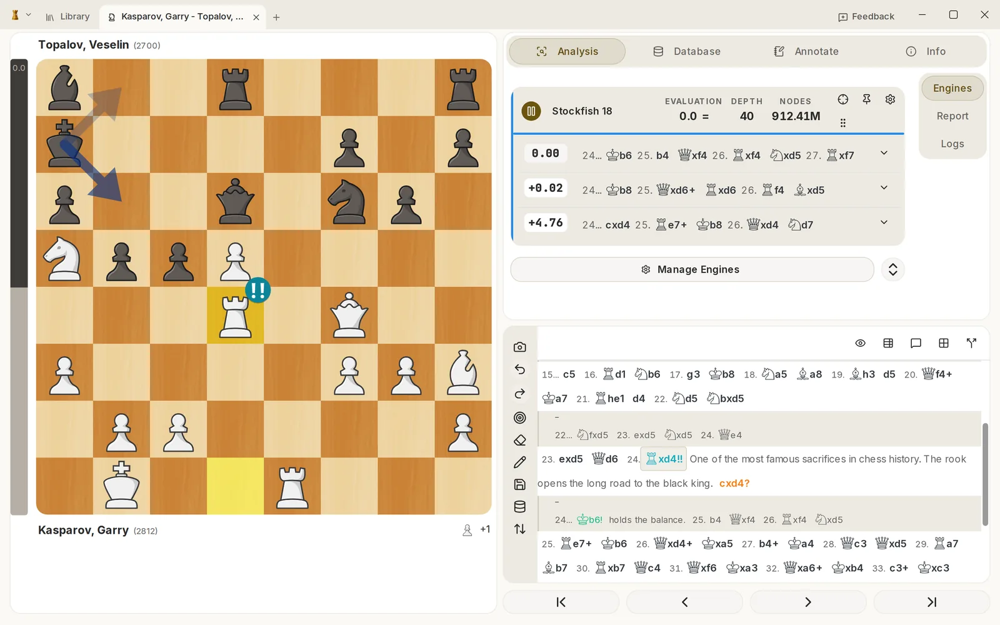
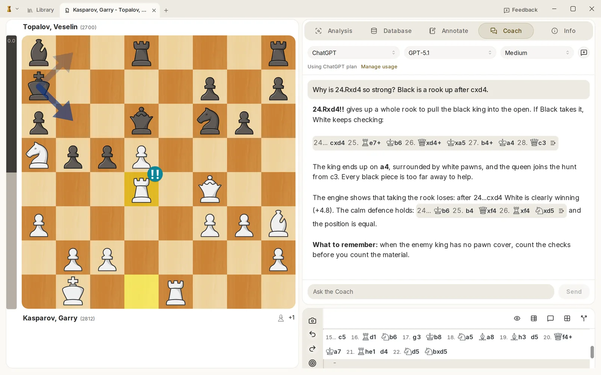
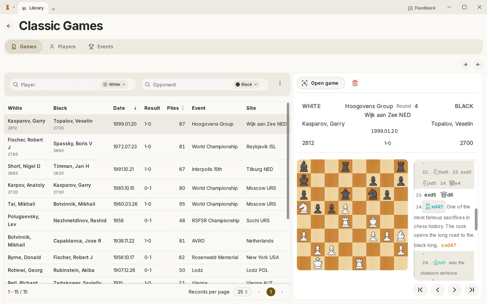

<br />
<div align="center">
  <a href="https://github.com/felixabeck/chessriddle-studio">
    
  </a>

<h3 align="center">ChessRiddle Studio</h3>

  <p align="center">
    Analyse games, search databases, play against engines
    <br />
    <a href="https://github.com/felixabeck/chessriddle-studio"><strong>Source and support</strong></a>
    <br />
    <br />
    <a href="https://github.com/felixabeck/chessriddle-studio/issues">Issues</a>
    ·
    <a href="https://www.encroissant.org/docs">Upstream documentation</a>
  </p>
</div>

> **This is a modified version of [En Croissant](https://github.com/franciscoBSalgueiro/en-croissant).**
> Modified by Felix Beck since 2026-08-09, and released under the GNU General Public License v3.0
> with no warranty. Not affiliated with, nor endorsed by, the original project.

ChessRiddle Studio is an open-source, cross-platform chess GUI that aims to be powerful, customizable and easy to use. It is Felix Beck's fork of En Croissant. Downloads and release notes are at [chessriddle.com/studio](https://chessriddle.com/studio).



## Features

- **Coach:** ask an AI about the position on the board. It checks its answers with your own engine and can draw on your reference database and your repertoire. Sign in with ChatGPT or Grok, use an API key, or run a local model.
- **Assistant:** an AI helper that explains Studio, takes you to the right setting and helps you write feedback.
- **Analysis:** run several UCI engines side by side, get game reports, and undo or redo every edit on the board.
- **Notation:** open variations are marked and counted, transpositions into other chapters are marked, and ChessBase diagram markers are shown.
- **Databases:** store and search your games, with absolute or partial position search, side-by-side database comparison and an opening tree that merges several sources.
- **Online games:** import your games from [Lichess](https://lichess.org) and [Chess.com](https://chess.com), and link an opponent's online accounts to their player card.
- **Repertoire training:** build a repertoire and train it with spaced repetition, or train all repertoires for a set number of minutes, with the lines that come up most often in real games first.
- **Browser extension:** an "Analyze in ChessRiddle Studio" button on Lichess and Chess.com opens a finished game in Studio ([Chrome](https://chromewebstore.google.com/detail/jjacoekjgdobdagnphpghaaecehnkaga), [Firefox](https://addons.mozilla.org/firefox/addon/analyze-in-chessriddle-studio/), Safari inside the Mac app).
- **Safe saving:** unsaved games survive quitting and crashes.
- Simple engine and database installation and management, on Windows, macOS and Linux.





## Building from source

Refer to the [Tauri documentation](https://tauri.app/start/prerequisites/) for the requirements on your platform.

ChessRiddle Studio uses pnpm as the package manager for dependencies. Refer to the [pnpm install instructions](https://pnpm.io/installation) for how to install it on your platform.

```bash
git clone https://github.com/felixabeck/chessriddle-studio
cd chessriddle-studio
pnpm install
pnpm build
```

The built app can be found at `src-tauri/target/release`

## Contributing

For contributing to this project please refer to the [Contributing guide](./CONTRIBUTING.md).

## License

This software is licensed under GPL-3.0 License.

The Alpha chess piece set (`public/pieces/alpha.css`), designed by Eric Bentzen, is not covered by the GPL. Felix Beck holds a lifelong licence from the designer to use it in ChessRiddle Studio. Reselling the design or images based on it is not permitted. Outside ChessRiddle Studio, the designer's own terms apply: free for personal, non-commercial use.
